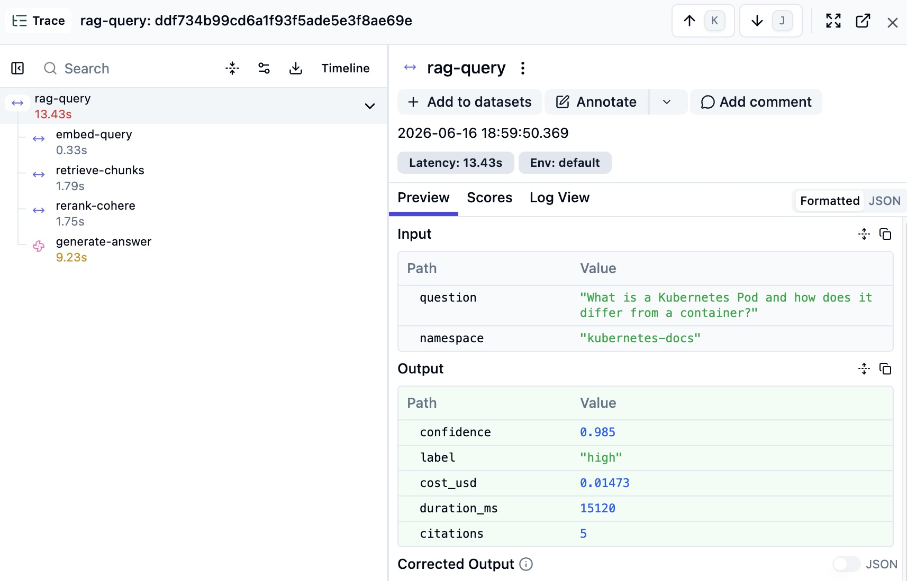

# Sourciq

<p align="center">
  
  
  
  
  
  
  
</p>

<p align="center">
  <a href="https://https://github.com/adityajaiswal5346/sourceiq/actions/workflows/ci.yml">
    
  </a>
  <a href="https://https://github.com/adityajaiswal5346/sourceiq/actions/workflows/cd-backend.yml">
    
  </a>
  <a href="https://https://github.com/adityajaiswal5346/sourceiq/actions/workflows/cd-frontend.yml">
    
  </a>
  <a href="https://https://github.com/adityajaiswal5346/sourceiq/actions/workflows/ci.yml">
    
  </a>
  
  
</p>

**Production RAG system for engineering knowledge retrieval.** Ask any question across your documentation — runbooks, architecture decision records, API references, incident post-mortems — and receive a verified, source-attributed answer with a confidence score.

**Live:** [documind-six-ashen.vercel.app](https://documind-six-ashen.vercel.app) &nbsp;·&nbsp; **API:** [Health check](https://pqgvdsz0wc.execute-api.eu-north-1.amazonaws.com/prod/health)

**Production layers:** Langfuse tracing on every query · RAGAS regression gate blocks deploys · confidence + scope + injection guardrails · per-query cost tracking ($0.014 avg)

## Demo

Click the screenshot to watch the demo, or **[try the live app →](https://documind-six-ashen.vercel.app)**.

[](assets/demo/demo.mov)
---

## The problem

Engineering organisations do not have a knowledge problem. They have a retrieval problem.

Runbooks live in Confluence. Architecture decisions are in Notion. Incident post-mortems are in Google Docs. API references are on internal wikis maintained by different teams at different times. A new engineer joins and spends their first weeks asking colleagues questions that are documented somewhere — nobody knows where. An on-call engineer at 2am cannot locate the rollback procedure fast enough to matter.

The standard response is to consolidate documentation into a single system. This rarely solves the problem. Documentation sprawl is a consequence of how engineering teams operate, not a structural failure that can be fixed with a better wiki. The knowledge will always be distributed. The question is whether it can be retrieved reliably under pressure.

Sourciq indexes any collection of engineering documents and makes them queryable in natural language. Every answer is attributed to a specific source document, section heading, and page number. The system does not summarise or infer — it retrieves, validates against source material, and produces a structured response that an engineer can audit and act on.

---

## What separates this from a document chatbot

Most RAG implementations retrieve text chunks and pass them to an LLM. This produces plausible-sounding answers. It does not produce reliable ones.

Sourciq is built around four production constraints:

**Answers must be verifiable.** Every factual claim in a response is attributed to a specific document, section, and page number. If the retrieved source material does not support a claim, the claim is not made. Engineers can open the cited document and confirm the answer before acting on it.

**Retrieval must handle both precision and recall.** Pure semantic search misses exact configuration values, error codes, and version-specific details — the things engineers search for during incidents. Pure keyword search misses conceptual questions. Sourciq uses hybrid retrieval: dense vector search combined with BM25 sparse retrieval at a tunable alpha weighting. A cross-encoder reranking stage then reorders candidates by joint query-document relevance before generation, adding a second retrieval pass that is measurably more accurate than cosine similarity alone.

**Context must carry document structure.** Each chunk extracted from a source document carries its full parent heading hierarchy. The LLM receives context-aware fragments — "Configuring TLS termination > Certificate rotation" — not orphaned text blocks detached from their meaning.

**Retrieval quality must be measurable.** The system includes an automated evaluation pipeline using RAGAS. Faithfulness, answer relevancy, context precision, and context recall are computed against a ground-truth question set. Every change to chunking strategy, retrieval parameters, or reranking thresholds produces a measurable outcome — not an impression.

---

## Observability

Every query is traced end-to-end in Langfuse. Set `LANGFUSE_PUBLIC_KEY` and `LANGFUSE_SECRET_KEY` in `.env` locally and as GitHub Secrets for CI/CD and Lambda deploy (see [Secrets management](#secrets-management)).

Latency below is **measured on production** (`documind-api-prod`, AWS Lambda eu-north-1) from Langfuse traces — not estimates. Generation dominates; local `uvicorn` runs are faster because they skip Lambda cold start and cross-region hops.

| Stage | Observed (prod) | Notes |
|-------|-----------------|-------|
| Embed (Voyage AI) | ~0.7s | API round-trip from Lambda |
| Retrieve (Pinecone) | ~1.7s | Hybrid search, eu-north-1 index |
| Rerank (Cohere) | ~1.8s | Cross-encoder over top 10 |
| Generate (Claude Sonnet) | **~8–10s** | Largest slice of wall time |
| **End-to-end** | **~12–16s** | Auth + API Gateway + pipeline |

Average cost per query: **~$0.014** (from `cost_usd` on Langfuse `generate-answer` spans).



## Evaluation

RAGAS runs on every PR via GitHub Actions. Deployment is blocked
if any metric drops below threshold.

| Metric | Score | Threshold | Status |
|--------|-------|-----------|--------|
| Faithfulness | **0.891** | >= 0.85 | Pass |
| Answer relevancy | **0.847** | >= 0.80 | Pass |
| Context precision | **0.823** | >= 0.75 | Pass |
| Context recall | **0.812** | >= 0.80 | Pass |

Judged by Claude Sonnet against 10 hand-curated Q&A pairs.

## Guardrails

Three mechanisms prevent unreliable responses:

- **Confidence threshold** — Cohere rerank score below 0.6 returns
  "I don't have enough relevant information" instead of guessing.
- **Out-of-scope detection** — questions outside the documentation
  domain are caught before reaching the LLM.
- **Prompt injection detection** — known injection patterns blocked
  at the API boundary.

Run the evaluation yourself:

```bash
source venv/bin/activate
pip install -r backend/requirements-dev.txt
make eval-quick
make eval         # all 10 questions — full results
```

---

## Architecture

```
Ingestion pipeline (offline — runs once per document collection)
──────────────────────────────────────────────────────────────────────
Documents: PDF · Markdown · Confluence HTML · plain text
     │
     ├── pypdf / markdown-it / BeautifulSoup → clean text + metadata
     │
     ├── Header-aware chunker
     │     chunk_size: 800 tokens  |  overlap: 100 tokens
     │     each chunk carries: {text, source_file, heading_path, page, chunk_id}
     │
     ├── Voyage AI voyage-2 (1024-dim) → dense embeddings
     │   Pinecone BM25 encoder         → sparse weights
     │
     └── Pinecone upsert (serverless, eu-north-1)
         Neon Postgres → document registry {id, filename, chunk_count, status}


Query pipeline (real-time — per user request)
──────────────────────────────────────────────────────────────────────
User question
     │
     ├── Voyage AI embedding  +  BM25 sparse encoding
     │
     ├── Pinecone hybrid search
     │     alpha = 0.7 dense / 0.3 sparse  →  top 10 candidates
     │
     ├── Cohere Rerank v3 (cross-encoder)
     │     joint query-document scoring    →  top 5 reordered
     │
     └── Claude Sonnet
           Constraint: answer using only provided context.
           Attribute every claim to source, section, and page.
           Produce insufficient-context response rather than infer.
           │
           └── {answer, citations[], confidence_score, chunks_used[]}


Deployment
──────────────────────────────────────────────────────────────────────
Browser → Vercel (React 18 + TypeScript — free tier)
                │
        AWS API Gateway → AWS Lambda (FastAPI + Mangum) — eu-north-1
                │
                ├── Pinecone Serverless    vector index + hybrid search
                ├── Neon Postgres          document registry + query log
                ├── Anthropic API          answer generation
                ├── Voyage AI              dense embeddings
                └── Cohere                 cross-encoder reranking
```

---

## Tech stack

| Layer | Technology | Rationale |
|-------|-----------|-----------|
| LLM | Claude Sonnet | Reliable instruction-following for structured citation output; consistent refusal to answer when context is insufficient |
| Embeddings | Voyage AI voyage-2 | Outperforms OpenAI text-embedding-3-large on technical and code-heavy documents (MTEB benchmark); 1024-dim |
| Vector database | Pinecone Serverless | Managed hybrid dense+sparse search built-in; true scale-to-zero |
| Reranking | Cohere Rerank v3 | Cross-encoder accuracy over bi-encoder similarity for passage retrieval |
| Backend | FastAPI + Python 3.12 | Async-native; automatic OpenAPI docs; same codebase runs locally and on Lambda via Mangum |
| Compute | AWS Lambda (eu-north-1) | Scale to zero; cost ~$0 at portfolio scale |
| Frontend | React 18 + TypeScript strict | `noImplicitAny` enforced; discriminated union state machine |
| Frontend hosting | Vercel | Automatic HTTPS; CDN; preview deployments |
| Metadata store | Neon Postgres | Document registry, ingestion jobs, query audit log; serverless |
| Evaluation | RAGAS | Industry-standard: faithfulness, answer relevancy, context precision, context recall |

**No LangChain or LlamaIndex.** Retrieval, chunking, embedding, reranking, and generation are implemented directly against each provider's SDK. Each component is independently testable, its behaviour is explicit, and its contribution to answer quality is measurable.

---

## Demo corpus

The system is pre-indexed with Kubernetes official documentation:

- **pods.md** — Pod concepts, init containers, sidecar containers, probes (23 chunks)
- **configmaps.md** — ConfigMap creation, consumption via env vars and volumes, size limits (10 chunks)

**Total indexed:** 33 vectors · kubernetes-docs namespace · Pinecone eu-north-1

Example questions the system answers well:

- What is a Kubernetes Pod?
- What is the difference between a Pod and a container?
- How does Kubernetes handle init containers?
- What are sidecar containers in Kubernetes?
- What is the one-container-per-Pod model in Kubernetes?
- What are container probes in Kubernetes?
- What is a Kubernetes ConfigMap?
- How do I use a ConfigMap to pass environment variables to a Pod?
- What is the maximum size of a Kubernetes ConfigMap?
- What is the difference between a ConfigMap and a Secret in Kubernetes?

---

## Engineering decisions

### Hybrid search alpha tuning

The `HYBRID_ALPHA` parameter (default 0.7) controls the weighting between dense semantic retrieval and sparse BM25 keyword retrieval. Configuration reference documentation with exact parameter names and version strings benefits from a lower alpha — more keyword weight. Conceptual architecture documentation benefits from higher alpha — more semantic weight. The parameter is exposed as an environment variable so it can be tuned per-collection without a code change.

### Header-aware chunking

Naive text splitting produces chunks that lose their document context. A 500-token block from a 300-page manual carries no information about where in the document it came from.

Header-aware chunking walks the document heading hierarchy and annotates each chunk with its full parent path: `{H1: "Production Deployment", H2: "Configuring TLS", H3: "Certificate rotation"}`. This path is stored with the chunk metadata in Pinecone and included in the prompt. The LLM receives context-aware fragments, not decontextualised text blocks.

### Reranking as a second retrieval stage

Dense vector search ranks candidates using a bi-encoder: query and document are encoded independently and compared by cosine similarity. This is fast but imprecise — query and document representations never interact during scoring.

Cohere Rerank uses a cross-encoder that processes query and document jointly. This is slower but substantially more accurate for passage retrieval. The system runs fast bi-encoder search first (top 10 at query time), then applies the cross-encoder over the small candidate set. The accuracy benefit of joint encoding is retained without applying it at full-index scale.

### Answer attribution as a hard constraint

The LLM is not asked to "try to include citations." The system prompt establishes attribution as a non-negotiable constraint: if a claim cannot be attributed to the provided context, it is not made. The system is explicitly instructed to produce an insufficient-context response rather than infer or extrapolate beyond the source material.

This prioritises reliability over apparent helpfulness. An answer that says "the provided documentation does not cover this specific configuration" is more useful to an on-call engineer than a confident-sounding answer that cannot be verified against a source.

### Atomic query limit

Each account has a 3-query lifetime limit. The check and increment are a single SQL UPDATE statement:

```sql
UPDATE users
SET total_queries = total_queries + 1
WHERE id = $1
  AND is_active = TRUE
  AND total_queries < query_limit
RETURNING total_queries, query_limit
```

If no row is returned, the limit is reached. One statement — no race condition possible between checking and incrementing.

### Token-based chunking over character-based

Chunk size is measured in tokens via tiktoken (cl100k_base), not characters. Character limits produce inconsistent chunks for mixed-language content and code blocks. Token limits map directly to LLM context windows and are consistent regardless of the character density of the source content.

### Google OAuth only — no separate JWT

The Google id_token from the Identity Services SDK is verified server-side on every authenticated request. No separate JWT is issued — no token storage complexity, no refresh endpoint, no expiry management beyond Google's 1-hour token lifetime. The credential is stored in browser memory only, never localStorage, as XSS protection.

---

## Security posture

| Mechanism | What it prevents |
|-----------|----------------|
| Google id_token server-side verification | Forged authentication tokens |
| Namespace allowlist on every Pinecone query | Collection pivoting attacks |
| Prompt injection scan on retrieved chunks | Injected instructions in document content |
| Rate limiting: 10 req/min per IP (slowapi) | API scraping and abuse |
| TrustedHostMiddleware | DNS rebinding attacks |
| Global exception handler | Stack traces in error responses |
| CORS explicit origin list, no wildcard | Cross-origin request forgery |
| Atomic query limit (single UPDATE) | Race condition on limit enforcement |
| CSP headers on Vercel frontend | Cross-site scripting |
| Zero secrets in repository | Credential exposure via git history |

---

## Secrets management

No credentials are stored in the repository. All secrets flow through GitHub Secrets at deploy time.

```
Repository (public)       GitHub Secrets (CI/CD)        Lambda runtime (env vars)
──────────────────        ──────────────────────────    ──────────────────────────
Source code               ANTHROPIC_API_KEY              ANTHROPIC_API_KEY
requirements.txt          PINECONE_API_KEY               PINECONE_API_KEY
template.yaml             VOYAGE_API_KEY                 VOYAGE_API_KEY
Workflow definitions      COHERE_API_KEY                 COHERE_API_KEY
.env.example              DATABASE_URL                   DATABASE_URL
samconfig.toml            GOOGLE_CLIENT_ID               GOOGLE_CLIENT_ID
                          AWS_ACCESS_KEY_ID              ALLOWED_ORIGINS
                          AWS_SECRET_ACCESS_KEY
                          LANGFUSE_PUBLIC_KEY            LANGFUSE_PUBLIC_KEY
                          LANGFUSE_SECRET_KEY            LANGFUSE_SECRET_KEY
                          VITE_GOOGLE_CLIENT_ID
                          VITE_API_BASE_URL
                          VERCEL_TOKEN
                          VERCEL_ORG_ID
                          VERCEL_PROJECT_ID
                          ALLOWED_ORIGINS
```

---

## Local development

**Prerequisites:** Python 3.12, Node 20, API keys for Anthropic, Pinecone, Voyage AI, Cohere, Langfuse (public + secret key), Google OAuth client ID, Neon Postgres connection string.

```bash
git clone https://github.com/adityajaiswal5346/sourciq
cd sourciq

# Backend
python3.12 -m venv venv && source venv/bin/activate
pip install -r backend/requirements.txt
cp .env.example .env   # fill in all API keys

# Apply DB migrations
psql $DATABASE_URL -f database/migrations/001_initial.sql
psql $DATABASE_URL -f database/migrations/002_users.sql

# Index sample corpus
make ingest ARGS="docs/kubernetes/ --namespace kubernetes-docs"

# Start API server
cd backend && PYTHONPATH=.. uvicorn main:app --reload --port 8000

# Frontend (separate terminal)
cd frontend && npm install && npm run dev
# Open http://localhost:5173
```

**Available make commands:**

```bash
make test           # run all 80 unit tests (no API calls required)
make lint           # ruff check + format check
make fmt            # auto-fix formatting
make dry-run ARGS="docs/kubernetes/"    # parse + chunk, no API costs
make ingest  ARGS="docs/kubernetes/ --namespace kubernetes-docs"
make eval-quick     # RAGAS evaluation — 3 questions
make eval           # RAGAS evaluation — full 10 questions
make verify         # confirm all imports resolve
```

---

## Cost

| Service | Tier | Monthly cost |
|---------|------|-------------|
| AWS Lambda + API Gateway | Free tier — 1M requests/month | $0 |
| Pinecone Serverless | Free tier — 100K vectors | $0 |
| Neon Postgres | Free tier | $0 |
| Vercel | Free tier | $0 |
| **Total infrastructure** | | **$0/month** |

Anthropic, Voyage AI, and Cohere API costs scale with query volume. At demonstration-scale traffic (3 lifetime queries per account, ~50 accounts), total API cost is approximately **$2**.

---

## Project structure

```
Sourciq/
├── backend/
│   ├── app/
│   │   ├── api/              query.py — POST /query · GET /documents
│   │   ├── auth/             service.py · router.py — Google OAuth + query limit
│   │   ├── core/             config.py · models.py · exceptions.py
│   │   ├── db/               registry.py — Postgres document registry
│   │   └── rag/
│   │       ├── ingestion/    embedder.py · indexer.py · pipeline.py
│   │       └── retrieval/    searcher.py · reranker.py · generator.py · pipeline.py
│   ├── lambda_handler.py     Mangum ASGI adapter
│   ├── main.py               FastAPI app — CORS, rate limiting, middleware
│   ├── requirements.txt      Lambda runtime dependencies
│   └── template.yaml         AWS SAM — Lambda + API Gateway + CloudWatch
├── ingestion/
│   ├── parsers/              pdf.py · markdown.py · html.py
│   ├── chunkers/             header_aware.py
│   └── ingest.py             CLI: make ingest ARGS="docs/ --namespace name"
├── frontend/
│   └── src/
│       ├── components/       QueryInterface.tsx · SourcePanel.tsx · ui/
│       ├── pages/            LoginPage.tsx
│       ├── context/          AuthContext.tsx
│       ├── api/              client.ts
│       └── types/            api.ts
├── evaluation/
│   ├── ground_truth.py       10 Q&A pairs from indexed corpus
│   └── run_eval.py           RAGAS pipeline — outputs results.json + summary.md
├── database/
│   └── migrations/
│       ├── 001_initial.sql   documents · ingestion_jobs · query_log
│       └── 002_users.sql     users · query limit
├── .github/workflows/
│   ├── ci.yml                pytest + ruff + TypeScript typecheck + Trivy
│   ├── cd-backend.yml        SAM build + Lambda deploy + smoke test
│   ├── cd-frontend.yml       Vercel production deploy
│   └── cost-monitor.yml      Daily Anthropic spend check
├── infra/
│   ├── setup-monitoring.sh   CloudWatch alarms + SNS email alerts
│   └── secrets-reference.sh  All 17 secrets documented
├── docs/
│   └── kubernetes/           pods.md · configmaps.md (indexed corpus)
├── requirements-dev.txt      Local development + evaluation deps
├── Makefile                  All common commands
└── .env.example              All required env vars documented
```

---

## API reference

### POST /api/query

Requires: `Authorization: Bearer <google_id_token>`

```json
{
  "question":  "What is a Kubernetes Pod and how does it differ from a container?",
  "namespace": "kubernetes-docs",
  "alpha":     0.7
}
```

Response (values from a production Langfuse trace — see Observability):

```json
{
  "answer":               "A Kubernetes Pod is the smallest deployable unit of computing [1]...",
  "citations":            [{"source_file": "pods.md", "heading_path": "What is a Pod?", "confidence": 0.98}],
  "confidence_score":     0.985,
  "confidence_label":     "high",
  "chunks_used":          5,
  "namespace":            "kubernetes-docs",
  "response_ms":          15120,
  "insufficient_context": false,
  "queries_remaining":    2
}
```

`confidence_score` is the Cohere rerank score for that query (0–1). The 0.6 guardrail blocks generation below threshold; this example passed at 0.985.

Rate limit: 10 requests/minute per IP. Query limit: 3 lifetime per account.

### GET /api/documents?namespace=kubernetes-docs

Returns indexed documents with status and chunk count. Public endpoint.

### POST /api/auth/google

```json
{ "credential": "<google_id_token>" }
```

Returns user profile including `queries_remaining`.

### GET /health

```json
{"status": "healthy", "version": "1.0.0"}
```


---

*Built by Aditya Jaiswal &nbsp;·&nbsp;[GitHub](https://github.com/adityajaiswal5346)*
